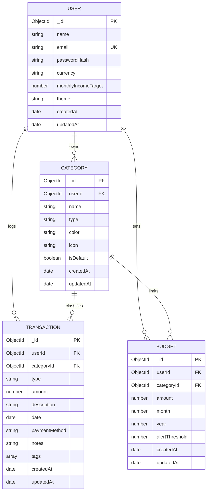

# ExpenseFlow — Database Schema & Architecture Reference

## 1. Overview

**ExpenseFlow** utilizes MongoDB as its primary document store, managed through Mongoose ODM. The database name is `expenseflow`.

The database architecture is designed with:
- **Strict User Isolation**: All transactional, budget, and custom category documents are bound to an authenticated user's `ObjectId` via index-enforced referential ownership.
- **Optimized Compound Indexes**: High-performance querying, range scans, and unique constraints.
- **Application & Schema Validation**: Strict type enforcement, positive value validation, and date validation.
- **Referential Integrity Guards**: Soft-blocking category deletions when transactions or budgets reference them.

---

## 2. Entity Relationship & Collection Model



---

## 3. Detailed Collection Schemas

### A. `users` Collection

Represents registered platform accounts with credentials and financial preferences.

| Field | BSON Type | Constraints | Description |
|---|---|---|---|
| `_id` | ObjectId | Primary Key, Auto-generated | Unique user identifier |
| `name` | String | Required, Trim, Length: 2–100 | Full name of the user |
| `email` | String | Required, Unique, Lowercase, Trim, Regex | Normalized email for login |
| `passwordHash` | String | Required | Salted bcrypt hash ($2a$ / $2b$) |
| `currency` | String | Default: 'INR', Enum: ['INR', 'USD', 'EUR', 'GBP', 'CAD', 'AUD', 'JPY'] | Preferred display currency |
| `monthlyIncomeTarget` | Number | Optional, Min: 0, Default: 0 | User benchmark income |
| `theme` | String | Enum: ['light', 'dark'], Default: 'light' | Dashboard UI theme preference |
| `createdAt` | Date | Timestamps: true | Account creation timestamp |
| `updatedAt` | Date | Timestamps: true | Account modification timestamp |

#### Indexes:
- `{ email: 1 }` — **Unique Index**: Enforces account uniqueness and provides $O(1)$ lookup during authentication.

---

### B. `categories` Collection

Represents income and expense classifications. Every user receives a seeded bundle of default categories upon registration and can define custom ones.

| Field | BSON Type | Constraints | Description |
|---|---|---|---|
| `_id` | ObjectId | Primary Key | Unique category identifier |
| `userId` | ObjectId | Required, Ref: 'User', Indexed | Owner user ID |
| `name` | String | Required, Trim, Max length: 60 | Category display name |
| `type` | String | Required, Enum: ['income', 'expense'] | Type classification |
| `color` | String | Default: '#3b82f6', Hex pattern | Hex color code for UI cards and charts |
| `icon` | String | Default: 'tag' | Lucide icon identifier |
| `isDefault` | Boolean | Default: false | True if created during initial account seeding |
| `createdAt` | Date | Timestamps: true | Creation timestamp |
| `updatedAt` | Date | Timestamps: true | Modification timestamp |

#### Indexes:
- `{ userId: 1, name: 1, type: 1 }` — **Compound Unique Index**: Prevents duplicate category names of the same type under the same account.
- `{ userId: 1 }` — Single-field index for fetching all categories belonging to a user.

---

### C. `transactions` Collection

Represents granular financial inflows (income) and outflows (expenses).

| Field | BSON Type | Constraints | Description |
|---|---|---|---|
| `_id` | ObjectId | Primary Key | Unique transaction record ID |
| `userId` | ObjectId | Required, Ref: 'User', Indexed | Owner user ID |
| `categoryId` | ObjectId | Required, Ref: 'Category' | Associated category reference |
| `type` | String | Required, Enum: ['income', 'expense'] | Transaction direction |
| `amount` | Number | Required, Min: 0.01, Precision: 2 decimals | Monetary value |
| `description` | String | Required, Trim, Max length: 200 | Description of transaction |
| `date` | Date | Required, Default: Date.now | Transaction event date |
| `paymentMethod` | String | Required, Enum: ['cash', 'UPI', 'card', 'bank transfer', 'other'] | Payment rail used |
| `notes` | String | Optional, Trim, Max length: 500 | Additional user commentary |
| `tags` | Array of Strings | Optional, Default: [] | Metadata tags (e.g. `['campus', 'dining']`) |
| `createdAt` | Date | Timestamps: true | Creation timestamp |
| `updatedAt` | Date | Timestamps: true | Modification timestamp |

#### Currency Precision Strategy:
Monetary values are stored as IEEE 754 floating-point numbers rounded to two decimal places at the model setter stage:
```javascript
set: (val) => Math.round(Number(val) * 100) / 100
```
This guarantees that values like `42.5000000001` are never saved into MongoDB, eliminating floating-point drift in aggregation sums.

#### Indexes:
- `{ userId: 1, date: -1 }` — **Compound Index**: Optimizes the default chronologically sorted transaction list.
- `{ userId: 1, type: 1, date: -1 }` — **Compound Index**: Optimizes filtering by income/expense within date intervals.
- `{ userId: 1, categoryId: 1, date: -1 }` — **Compound Index**: Speeds up category breakdown aggregations and budget spent lookups.
- `{ userId: 1, paymentMethod: 1, date: -1 }` — **Compound Index**: Accelerates payment channel analytics.

---

### D. `budgets` Collection

Defines monthly budget ceilings for individual expense categories.

| Field | BSON Type | Constraints | Description |
|---|---|---|---|
| `_id` | ObjectId | Primary Key | Unique budget record ID |
| `userId` | ObjectId | Required, Ref: 'User', Indexed | Owner user ID |
| `categoryId` | ObjectId | Required, Ref: 'Category' | Expense category ID |
| `amount` | Number | Required, Min: 0.01 | Budget allocation limit |
| `month` | Number | Required, Min: 1, Max: 12 | Calendar month (1 = Jan, 12 = Dec) |
| `year` | Number | Required, Min: 2000, Max: 2100 | Calendar year |
| `alertThreshold` | Number | Default: 80, Min: 1, Max: 100 | Percentage threshold for visual alert |
| `createdAt` | Date | Timestamps: true | Creation timestamp |
| `updatedAt` | Date | Timestamps: true | Modification timestamp |

#### Non-Redundancy Architecture:
Actual expenditure is **not** stored in the `budgets` document. Instead, spending is dynamically computed via aggregation pipelines matching transactions within the given month boundaries. This prevents data desynchronization when transactions are added, edited, or deleted.

#### Indexes:
- `{ userId: 1, categoryId: 1, month: 1, year: 1 }` — **Compound Unique Index**: Ensures only one budget entry can exist per category per month for any given user.

---

## 4. Referential Integrity Strategy

MongoDB does not provide foreign key constraints by default. ExpenseFlow enforces referential integrity at the application controller layer:
1. **Ownership Pre-check**: When creating transactions or budgets, the target `categoryId` is queried with `{ _id: categoryId, userId: req.user._id }`. If not found, a `400 Bad Request` is returned.
2. **Type Compatibility**: Transactions of type `expense` cannot be assigned to an `income` category, and budgets cannot be assigned to `income` categories.
3. **Deletion Block**: When deleting a category, the system checks:
   - `Transaction.countDocuments({ userId, categoryId })`
   - `Budget.countDocuments({ userId, categoryId })`
   If count > 0, the deletion is rejected with an informative error message instructing the user to reassign transactions first.
