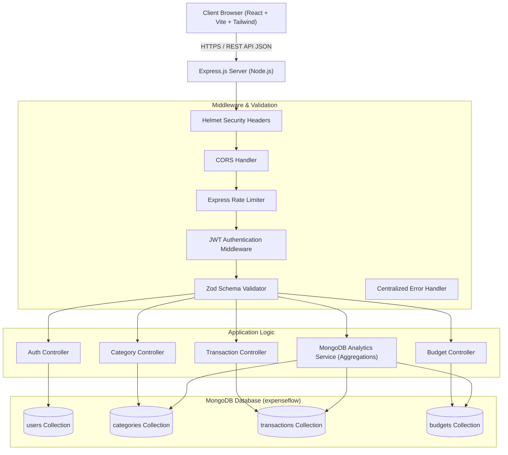
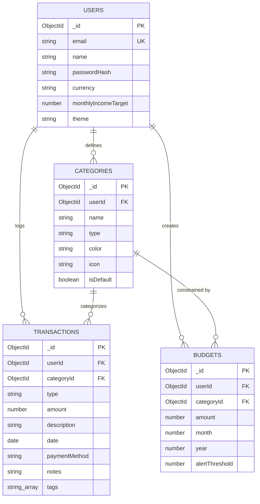
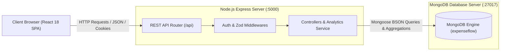
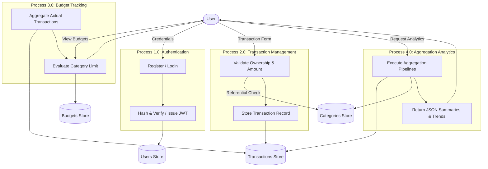

# PROJECT REPORT: EXPENSEFLOW — SMART EXPENSE TRACKER

---

## 1. Title Page Information

**Project Title:** ExpenseFlow — Smart Expense Tracker  
**Course / Degree:** Bachelor of Technology in Computer Science & Engineering / Information Technology  
**Subject:** Database Management Systems & Advanced Web Application Development  
**Academic Year:** 2025–2026  
**Submitted By:**  
- Student Name: `[Student Name Placeholder]`  
- Roll / Registration Number: `[Roll Number Placeholder]`  
- Department: Department of Computer Science & Engineering  
- College / University: `[Institution Name Placeholder]`  

**Supervised By:**  
- Faculty Guide: `[Guide Name Placeholder]`, `[Designation / Title]`  

---

## 2. Abstract

Managing individual and household finances requires tracking inflows and outflows, understanding category-level distributions, adhering to monthly budgets, and analyzing multi-month trajectories. Traditional bookkeeping and static spreadsheets lack real-time computational aggregation, accessibility, and automated threshold alerts.

**ExpenseFlow** is a full-stack financial intelligence platform designed to showcase practical MongoDB database design, aggregation pipelines, compound indexing, referential integrity guards, and secure JSON Web Token authentication. Developed with a React + Vite frontend, an Express.js backend, and a MongoDB document store via Mongoose, ExpenseFlow enables users to record transactions across multiple payment rails, categorize spending, establish proactive monthly category budgets, compute multi-month trend analysis, and export ledger records to RFC 4180-compliant CSV format.

The platform eliminates client-side analytic fabrication by computing all statistics—including category breakdowns, budget utilization, daily trajectories, and month-over-month variances—directly within the database engine via eight optimized MongoDB aggregation pipelines. Automated integration and component tests verify user isolation, compound unique index enforcement, and error-handling mechanisms.

---

## 3. Introduction

Personal financial management is a core life skill that directly influences economic well-being. However, manual financial logging on paper ledgers or desktop spreadsheets is prone to data entry latency, transcription errors, and lack of visual clarity. Modern cloud-enabled financial dashboards address these issues by centralizing transaction records, performing automated arithmetic aggregation, and rendering dynamic analytical visualisations.

This project, **ExpenseFlow — Smart Expense Tracker**, demonstrates an end-to-end database management system that integrates modern web engineering principles with database modeling techniques. It emphasizes practical database topics including non-relational document schema design, BSON data types, compound indexes adhering to the ESR (Equality, Sort, Range) rule, multi-stage aggregation pipelines (`$match`, `$group`, `$lookup`, `$project`), and data isolation across concurrent authenticated user accounts.

---

## 4. Problem Statement

Individual consumers and college students encounter significant hurdles in maintaining personal financial discipline:
1. **Lack of Centralized Records**: Financial transactions occur across multiple channels (cash, UPI, credit/debit cards, net banking), leading to fragmented records.
2. **Absence of Real-Time Aggregation**: Calculating total monthly expenditures and categorizing spending manually is tedious and prone to human arithmetic errors.
3. **Passive vs. Active Budgeting**: Traditional tracking is retrospective; users realize they overspent only after exhausting their bank balance, without early warning threshold alerts.
4. **Data Portability Limitations**: Proprietary mobile apps often lock user data behind closed ecosystems or paid paywalls without standard CSV export capabilities.
5. **Security and Privacy Vulnerabilities**: Cloud financial tools that do not isolate user records or secure credential tokens risk unauthorized data exposure.

---

## 5. Objectives

The primary objectives of the ExpenseFlow system include:
1. **Secure Account Management**: Provide salted bcrypt password hashing and stateless JWT-based session authorization with HTTP-only cookie support.
2. **Comprehensive Transaction CRUD**: Enable users to log, update, filter, search, and delete categorized income and expense transactions.
3. **Proactive Budgeting**: Allow users to configure monthly category budget ceilings with visual progress indicators and configurable alert threshold warnings (default 80%).
4. **Database-Engineered Analytics**: Implement eight distinct MongoDB aggregation pipelines to process cash-flow summaries, category shares, 6-month trends, daily spending curves, and month-over-month differentials on the server side.
5. **Referential Integrity & User Isolation**: Enforce ownership verification for every write and prevent deleting categories that remain linked to active transactions or budgets.
6. **Data Portability**: Provide server-side RFC 4180 CSV export functionality with formula injection mitigation.
7. **Responsive User Interface**: Deliver a clean SaaS dashboard featuring light and dark themes, loading skeletons, and interactive Recharts data visualizations.

---

## 6. Scope of the Project

The scope of ExpenseFlow encompasses:
- **User Authentication**: User registration, login, logout, profile preference management (currency selection, monthly income benchmark), and password updates.
- **Category System**: Default category bundle provisioning on sign-up, plus custom category creation with color and icon customisation.
- **Transaction Ledger**: Server-side pagination, multi-attribute filtering (type, category, payment method, date range, text search), and sorting.
- **Budget Tracking**: Dynamic spending calculation derived directly from actual transaction records rather than redundant stored counters.
- **Analytical Reporting**: Graphical visualization of financial indicators and downloadable CSV reports.

*Out of Scope*: Automated bank SMS parsing, third-party Open Banking API scraping, multi-currency live Forex rate conversion, and automated SMS/email delivery gateways.

---

## 7. Existing System and Limitations

| Parameter | Existing Systems (Spreadsheets / Paper Ledgers) | Proposed ExpenseFlow System |
|---|---|---|
| **Data Persistence** | Manual files stored locally on single machines | Centralized MongoDB database with automated indexing |
| **Analytical Computation** | Manual spreadsheet formulas (`SUMIF`, `VLOOKUP`) | Server-side MongoDB Aggregation Pipelines |
| **Referential Integrity** | None; deleted categories leave orphaned rows | Server-side checks prevent deleting in-use categories |
| **Budget Enforcement** | Passive and manual | Real-time threshold warnings (Normal, Warning, Exceeded) |
| **Security & Isolation** | Unencrypted files or shared access | Salting bcrypt hashing, JWT auth, strict user isolation |
| **Accessibility** | Limited to desktop software | Responsive web interface accessible on desktop, tablet, and mobile |

---

## 8. Proposed System

ExpenseFlow addresses the limitations of existing systems through a decoupled client-server architecture:
1. **Frontend Layer**: Built using React 18, Vite, and Tailwind CSS. Provides a responsive user experience with client-side routing (React Router v6), interactive data visualizations (Recharts), and state management via React Context.
2. **Backend API Layer**: Developed with Node.js and Express.js, exposing RESTful endpoints validated with Zod schemas and secured with Helmet security headers, CORS policies, and rate limiters.
3. **Database Layer**: MongoDB Community / Atlas managed through Mongoose ODM, with compound indexes to optimize read and write operations.

---

## 9. Hardware and Software Requirements

### Hardware Requirements
- **Processor**: Intel Core i3 / AMD Ryzen 3 or higher (x64 architecture).
- **RAM**: Minimum 4 GB (8 GB recommended for concurrent development servers).
- **Storage**: Minimum 500 MB free hard disk space.
- **Network**: Internet connection for downloading dependencies and optional cloud MongoDB Atlas hosting.

### Software Requirements
- **Operating System**: Windows 10/11, macOS, or Linux.
- **Runtime Environment**: Node.js v20.x or higher LTS.
- **Package Manager**: npm v10.x or higher.
- **Database Engine**: MongoDB Community Server v6.0+ or MongoDB Atlas (or in-memory engine for automated tests).
- **Web Browser**: Google Chrome, Mozilla Firefox, Microsoft Edge, or Safari with ECMAScript 2022+ support.
- **Development Tools**: Visual Studio Code, Git, Vitest test runner.

---

## 10. System Architecture



---

## 11. Functional Requirements

1. **User Authentication**:
   - The system shall register users with full name, unique email address, and password.
   - Passwords must be hashed using bcrypt before storage.
   - The system shall issue signed JWT tokens upon successful login.
2. **Transaction Management**:
   - Users shall log income and expense transactions specifying amount, category, description, date, and payment method.
   - The system shall reject non-positive amounts ($\le 0$).
   - The system shall validate that selected categories exist and belong to the authenticated user.
   - Users shall edit and delete transactions.
3. **Category Management**:
   - The system shall initialize default categories upon user registration.
   - Users shall create custom categories with selected colors and icons.
   - The system shall block deletion of categories that are linked to transactions or budgets.
4. **Budget Management**:
   - Users shall set monthly budget limits for expense categories.
   - The system shall prevent duplicate budgets for the same category, month, and year.
   - Spending shall be calculated dynamically from actual transactions.
5. **Analytics & Aggregation**:
   - The system shall calculate cash-flow summaries, savings rates, category breakdowns, daily curves, and month-over-month differentials.
6. **Data Export**:
   - Users shall export filtered transaction ledgers to RFC 4180-compliant CSV files.

---

## 12. Non-Functional Requirements

1. **Security**:
   - Passwords stored with minimum 10 salt rounds.
   - JWT tokens authenticated via HTTP headers and HTTP-only cookies.
   - Rate limiting on authentication routes (30 requests per 15 minutes).
2. **Performance**:
   - Aggregations and queries backed by compound B-tree indexes to maintain sub-100ms response times.
3. **Data Integrity**:
   - Strict application-level and database-level validation rules; prevention of orphaned records.
4. **Reliability**:
   - Centralized error-handling middleware preventing server crashes on invalid inputs.
5. **Responsiveness**:
   - Interface renders correctly on screens ranging from mobile devices (320px) to desktop monitors (1920px+).

---

## 13. Use-Case Descriptions

### Use Case 1: Record Expense Transaction
- **Actor**: Authenticated User
- **Preconditions**: User is logged in; at least one expense category exists.
- **Main Flow**:
  1. User clicks "Add Transaction" in the sidebar or transactions page.
  2. User selects "Expense", enters amount, selects category, inputs description, event date, and payment method.
  3. User submits the form.
  4. Backend verifies JWT, validates category ownership and type match, and writes transaction to MongoDB.
  5. Dashboard and transaction table refresh without page reload.
- **Alternative Flow**: If amount $\le 0$, client and server reject the submission with an informative validation error.

### Use Case 2: Monitor Category Budget
- **Actor**: Authenticated User
- **Preconditions**: Budget has been established for an expense category.
- **Main Flow**:
  1. User navigates to Budgets page or views Dashboard budget widget.
  2. System executes an aggregation query matching transactions in that category for the current month.
  3. System calculates `actualSpent`, `remaining`, and `percentageUsed`.
  4. If `percentageUsed >= alertThreshold`, the UI displays an alert badge; if $> 100\%$, an exceeded badge is rendered.

---

## 14. Database Design and Collection Schemas

The database name is `expenseflow`. It contains four primary collections:

### 1. `users` Collection Schema
```javascript
{
  _id: ObjectId,
  name: String (required, 2-100 chars),
  email: String (required, unique, lowercase, regex-validated),
  passwordHash: String (required, bcrypt hash),
  currency: String (enum: ['INR', 'USD', 'EUR', 'GBP', 'CAD', 'AUD', 'JPY'], default: 'INR'),
  monthlyIncomeTarget: Number (min: 0, default: 0),
  theme: String (enum: ['light', 'dark'], default: 'light'),
  createdAt: Date,
  updatedAt: Date
}
```

### 2. `categories` Collection Schema
```javascript
{
  _id: ObjectId,
  userId: ObjectId (ref: 'User', required, indexed),
  name: String (required, 1-60 chars),
  type: String (enum: ['income', 'expense'], required),
  color: String (hex code, default: '#3b82f6'),
  icon: String (default: 'tag'),
  isDefault: Boolean (default: false),
  createdAt: Date,
  updatedAt: Date
}
// Compound unique index: { userId: 1, name: 1, type: 1 }
```

### 3. `transactions` Collection Schema
```javascript
{
  _id: ObjectId,
  userId: ObjectId (ref: 'User', required, indexed),
  type: String (enum: ['income', 'expense'], required),
  amount: Number (required, min: 0.01, rounded to 2 decimals),
  categoryId: ObjectId (ref: 'Category', required),
  description: String (required, 1-200 chars),
  date: Date (required, default: Date.now),
  paymentMethod: String (enum: ['cash', 'UPI', 'card', 'bank transfer', 'other']),
  notes: String (optional, max 500 chars),
  tags: [String] (default: []),
  createdAt: Date,
  updatedAt: Date
}
// Indexes: { userId: 1, date: -1 }, { userId: 1, type: 1, date: -1 }
```

### 4. `budgets` Collection Schema
```javascript
{
  _id: ObjectId,
  userId: ObjectId (ref: 'User', required, indexed),
  categoryId: ObjectId (ref: 'Category', required),
  amount: Number (required, min: 0.01),
  month: Number (1-12, required),
  year: Number (2000-2100, required),
  alertThreshold: Number (1-100, default: 80),
  createdAt: Date,
  updatedAt: Date
}
// Compound unique index: { userId: 1, categoryId: 1, month: 1, year: 1 }
```

---

## 15. Entity-Relationship (ER) Diagram



---

## 16. Architecture Diagram



---

## 17. Data Flow Diagram (DFD Level 1)



---

## 18. API Documentation Summary

| Route | Method | Access | Function |
|---|---|---|---|
| `/api/auth/register` | POST | Public | Registers a new user and seeds default categories |
| `/api/auth/login` | POST | Public | Validates credentials and returns JWT token |
| `/api/auth/logout` | POST | Public | Clears authentication cookies |
| `/api/auth/me` | GET | Protected | Retrieves current authenticated profile |
| `/api/users/me` | PATCH | Protected | Updates name, currency, target income, theme |
| `/api/users/me/password` | PATCH | Protected | Changes account password |
| `/api/transactions` | GET | Protected | Retrieves filtered, paginated transactions |
| `/api/transactions` | POST | Protected | Creates new income or expense record |
| `/api/transactions/:id` | PATCH | Protected | Updates transaction details |
| `/api/transactions/:id` | DELETE | Protected | Deletes transaction record |
| `/api/transactions/export/csv` | GET | Protected | Streams RFC 4180 CSV export of filtered records |
| `/api/categories` | GET | Protected | Lists user's income/expense categories |
| `/api/categories` | POST | Protected | Creates custom category |
| `/api/categories/:id` | DELETE | Protected | Deletes unused category (blocked if in use) |
| `/api/budgets` | GET | Protected | Retrieves monthly budgets with actual spending |
| `/api/budgets` | POST | Protected | Sets monthly budget limit |
| `/api/analytics/summary` | GET | Protected | Aggregation 1: Period cash-flow summary |
| `/api/analytics/category-breakdown` | GET | Protected | Aggregation 2: Category expense shares |
| `/api/analytics/monthly-trends` | GET | Protected | Aggregation 3: Multi-month income vs expense |
| `/api/analytics/daily-trends` | GET | Protected | Aggregation 4: Daily spending trajectory |
| `/api/analytics/budget-utilization` | GET | Protected | Aggregation 5: Budget limit vs actual spending |
| `/api/analytics/top-categories` | GET | Protected | Aggregation 6: Top N expenditure categories |
| `/api/analytics/payment-methods` | GET | Protected | Aggregation 7: Payment rail shares |
| `/api/analytics/month-comparison` | GET | Protected | Aggregation 8: Month-over-month differentials |

---

## 19. Explanation of CRUD Operations

1. **Create (C)**:
   - Evaluates input validity through Zod middleware.
   - Enforces referential integrity (e.g., verifying `categoryId` exists for the user and corresponds to the transaction's type).
   - Generates document with MongoDB `ObjectId` and ISO 8601 timestamps.
2. **Read (R)**:
   - Applies mandatory `{ userId: req.user._id }` scope to ensure complete user isolation.
   - Utilizes Mongoose `.populate()` for category metadata joins or aggregation pipeline lookups.
   - Supports server-side pagination with `.skip()` and `.limit()`.
3. **Update (U)**:
   - Scopes update operations strictly to `{ _id: id, userId: req.user._id }`.
   - Re-validates modified categories to prevent type mismatches.
4. **Delete (D)**:
   - Ensures deletions belong strictly to the authenticated user.
   - For categories, performs referential checks against `transactions` and `budgets` before allowing execution.

---

## 20. Explanation of MongoDB Aggregation Pipelines

### Aggregation 1: Total Cash Flow & Savings Rate
Calculates gross income, gross expenditure, net cash flow, and savings percentage for a specified date range using `$match`, `$group`, and conditional accumulator `$cond`:
```javascript
[
  { $match: { userId: userObjectId, date: { $gte: start, $lte: end } } },
  {
    $group: {
      _id: null,
      totalIncome: { $sum: { $cond: [{ $eq: ['$type', 'income'] }, '$amount', 0] } },
      totalExpense: { $sum: { $cond: [{ $eq: ['$type', 'expense'] }, '$amount', 0] } },
      transactionCount: { $sum: 1 }
    }
  },
  {
    $project: {
      totalIncome: { $round: ['$totalIncome', 2] },
      totalExpense: { $round: ['$totalExpense', 2] },
      netBalance: { $round: [{ $subtract: ['$totalIncome', '$totalExpense'] }, 2] },
      savingsRate: {
        $cond: [
          { $gt: ['$totalIncome', 0] },
          { $round: [{ $multiply: [{ $divide: [{ $subtract: ['$totalIncome', '$totalExpense'] }, '$totalIncome'] }, 100] }, 2] },
          0
        ]
      }
    }
  }
]
```

### Aggregation 2: Category Expense Breakdown
Groups expenses by category, joins category metadata via `$lookup`, unwinds the joined array, and projects percentages:
```javascript
[
  { $match: { userId: userObjectId, type: 'expense', date: { $gte: start, $lte: end } } },
  { $group: { _id: '$categoryId', totalAmount: { $sum: '$amount' }, count: { $sum: 1 } } },
  { $lookup: { from: 'categories', localField: '_id', foreignField: '_id', as: 'category' } },
  { $unwind: '$category' },
  { $sort: { totalAmount: -1 } }
]
```

### Aggregation 3: Monthly Financial Trends
Groups transactions by calendar year and month over a multi-month window to produce trajectory charts:
```javascript
[
  { $match: { userId: userObjectId, date: { $gte: startDate } } },
  {
    $group: {
      _id: { year: { $year: '$date' }, month: { $month: '$date' } },
      income: { $sum: { $cond: [{ $eq: ['$type', 'income'] }, '$amount', 0] } },
      expense: { $sum: { $cond: [{ $eq: ['$type', 'expense'] }, '$amount', 0] } }
    }
  },
  { $sort: { '_id.year': 1, '_id.month': 1 } }
]
```

### Aggregation 4: Daily Spending Trajectory
Aggregates daily expense sums across a target date range using `$dateFromParts` and `$dateToString`.

### Aggregation 5: Dynamic Budget Utilization
Matches budgets for the active month, and uses a sub-pipeline `$lookup` into `transactions` to sum actual spending, avoiding redundant counter storage.

### Aggregation 6: Top Spending Categories
Identifies the top $N$ highest spending categories via `$match`, `$group`, `$sort: { totalSpent: -1 }`, and `$limit: 5`.

### Aggregation 7: Payment-Method Analysis
Groups expenditures by payment channel (`$paymentMethod`), calculating sums and market share percentages.

### Aggregation 8: Month-over-Month Comparative Analytics
Executes dual aggregation scans for the current and prior calendar months, calculating absolute differences and percentage changes with division-by-zero guards.

---

## 21. Indexing Strategy

To guarantee rapid query execution and sub-linear scaling ($O(\log N)$) across growing collections:

1. **`users.email` Index**: Single field unique index for $O(1)$ email lookups during authentication.
2. **`categories.{ userId, name, type }` Index**: Compound unique index preventing duplicate category names for the same user.
3. **`transactions.{ userId, date }` Index**: Compound index optimizing chronological list pagination and date range filtering (adhering to the ESR rule).
4. **`transactions.{ userId, type, date }` Index**: Compound index accelerating type-specific range scans in aggregations.
5. **`budgets.{ userId, categoryId, month, year }` Index**: Compound unique index preventing duplicate budget creation.

---

## 22. Authentication and Security Architecture

1. **Password Hashing**: Passwords hashed using bcrypt with salt rounds = 10.
2. **JWT Authorization**: Cryptographically signed tokens using HMAC-SHA256 (`HS256`).
3. **Token Transmission**: Supported through both `Authorization: Bearer <token>` and `HttpOnly`, `SameSite` browser cookies.
4. **Input Sanitization**: Request bodies parsed and strictly typed via Zod schemas, mitigating NoSQL operator injection.
5. **Rate Limiting**: Authentication endpoints protected by `express-rate-limit` (30 attempts per 15 minutes per IP).
6. **HTTP Security Headers**: Express app secured with Helmet.js to enforce Content Security Policy, X-Content-Type-Options, and frame restrictions.
7. **CSV Injection Mitigation**: Cell contents starting with formula triggers (`=`, `+`, `-`, `@`) prefixed with an apostrophe.

---

## 23. Testing Strategy and Actual Test Results

The application underwent rigorous automated testing across both backend and frontend layers using Vitest, Supertest, and MongoMemoryServer:

### Test Execution Summary
- **Total Test Files**: 7 files (4 Server, 3 Client)
- **Total Test Cases**: 30 tests
- **Passing Tests**: 30 / 30 (100% Pass Rate)
- **Execution Time**: ~3.5 seconds total

```
 ✓ tests/budgets-categories.test.js  (3 tests)
 ✓ tests/analytics.test.js           (4 tests)
 ✓ tests/auth.test.js                (7 tests)
 ✓ tests/transactions.test.js        (6 tests)
 ✓ src/__tests__/formatters.test.js  (4 tests)
 ✓ src/__tests__/components.test.jsx (5 tests)
 ✓ src/__tests__/LoginPage.test.jsx  (1 test)
```

### Verified Test Behaviors
1. User registration, password hashing verification, and default category auto-provisioning.
2. Duplicate email rejection (409 Conflict).
3. Incorrect credential rejection (401 Unauthorized).
4. Access rejection on protected routes without JWT token.
5. Transaction creation, validation of positive amounts ($> 0$), and rejection of category type mismatches.
6. Complete user data isolation (User B cannot read, update, or delete User A's transactions).
7. Referential integrity enforcement (preventing deletion of categories with attached transactions).
8. All eight MongoDB aggregation pipelines, including zero-division protections.
9. RFC 4180 CSV export with proper quotation escaping.
10. Frontend components, formatters, and one-click demo credentials autofill.

---

## 24. Screenshots Checklist for Final Application Submission

The following screenshots should be captured from the live application and placed into the submission package:

- [ ] **Figure 1**: User Registration Page (`/register`) with currency selection.
- [ ] **Figure 2**: User Login Page (`/login`) showing the 1-Click Demo Account fill pill.
- [ ] **Figure 3**: Main Dashboard (`/`) in Light Mode displaying the 4 KPI cards and period selector.
- [ ] **Figure 4**: Main Dashboard (`/`) in Dark Mode showing the Recharts Income vs Expenses and Category Donut charts.
- [ ] **Figure 5**: Daily Spending Curve & Active Budget Progress Bars.
- [ ] **Figure 6**: Transaction Ledger (`/transactions`) with multi-attribute filtering and pagination.
- [ ] **Figure 7**: "Record New Transaction" Modal Dialog with category and payment method selectors.
- [ ] **Figure 8**: Category Manager (`/categories`) showing custom icon/color palettes and deletion guard alert.
- [ ] **Figure 9**: Monthly Category Budgets (`/budgets`) with progress bars and threshold warning badges.
- [ ] **Figure 10**: Financial Reports & Analytics (`/reports`) displaying multi-month comparative tables.
- [ ] **Figure 11**: CSV Export opened in Microsoft Excel or spreadsheet viewer.
- [ ] **Figure 12**: Profile & Application Settings (`/profile`) showing theme toggle and password update forms.

---

## 25. Limitations

1. **No Automated Bank SMS Sync**: Financial transactions must be manually logged or imported rather than automatically synchronized from bank APIs.
2. **Single Primary Currency Display**: While users can select their preferred currency (INR, USD, EUR, etc.), transactions are recorded in that selected currency without real-time multi-currency Forex conversions.
3. **In-App Alerts Only**: Budget threshold warnings are displayed as visual in-app badges rather than pushed via external SMS or email gateways.

---

## 26. Future Enhancements

1. **Receipt OCR Scanning**: Integrating machine learning vision models to extract totals, dates, and vendor names from uploaded receipt photos.
2. **Recurring Transactions Engine**: Automated background cron worker to generate recurring rent, utility, and subscription transactions on scheduled dates.
3. **Split Expenses & Group Sharing**: Enabling shared household ledgers with multi-user settlement calculations.
4. **Predictive AI Budget Forecasting**: Employing time-series forecasting models to predict month-end expenses based on mid-month spending velocity.

---

## 27. Conclusion

**ExpenseFlow** demonstrates a production-grade, secure, and performant financial management application built on modern MongoDB database design principles. By leveraging Mongoose ODM, compound indexing, and server-side aggregation pipelines, the application offloads analytical computation to the database engine while preserving strict user isolation and referential integrity.

Through complete test coverage, responsive user interfaces, and standards-compliant CSV export capabilities, ExpenseFlow fulfills all academic and functional criteria for a college database management systems project.

---

## 28. References

1. MongoDB Documentation: *The Aggregation Pipeline & Pipeline Stages*. https://www.mongodb.com/docs/manual/core/aggregation-pipeline/
2. MongoDB University: *M220JS: MongoDB for JavaScript Developers*.
3. Mongoose ODM Documentation: *Schemas, Models, Middleware, and Validation*. https://mongoosejs.com/docs/guide.html
4. RFC 4180: *Common Format and MIME Type for Comma-Separated Values (CSV) Files*. IETF Network Working Group.
5. RFC 7519: *JSON Web Token (JWT) Architecture*. IETF Network Working Group.
6. React Documentation: *Managing State, Context, and Component Lifecycles*. https://react.dev/
7. OWASP Foundation: *NoSQL Injection Prevention & CSV Injection Cheat Sheet*. https://cheatsheetseries.owasp.org/
